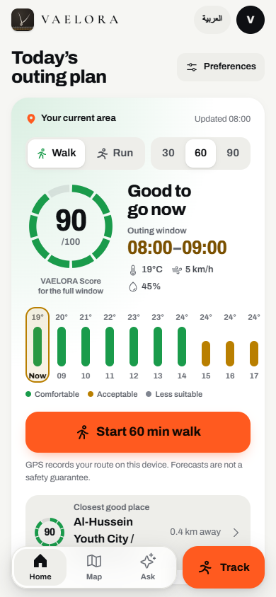
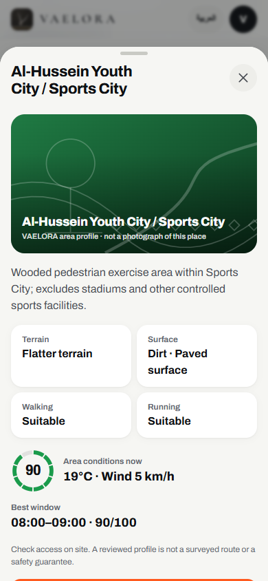
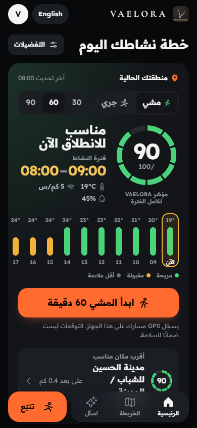
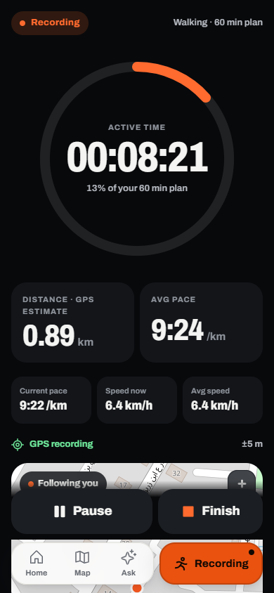
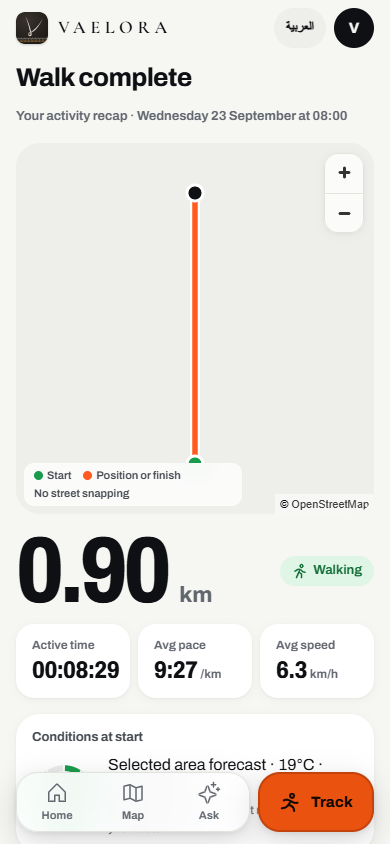
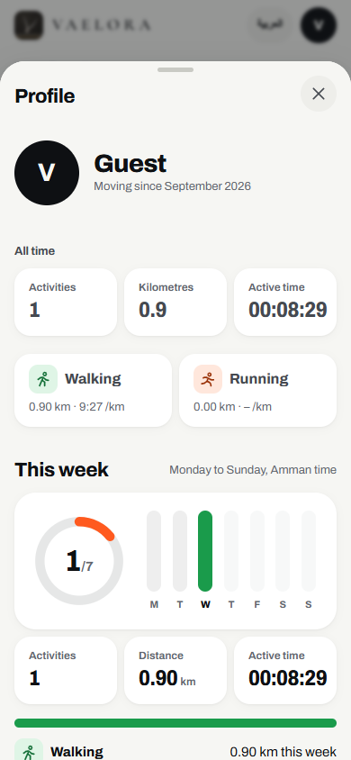
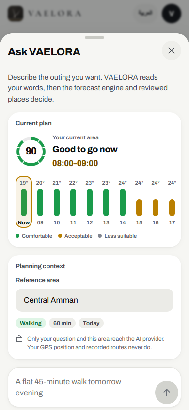
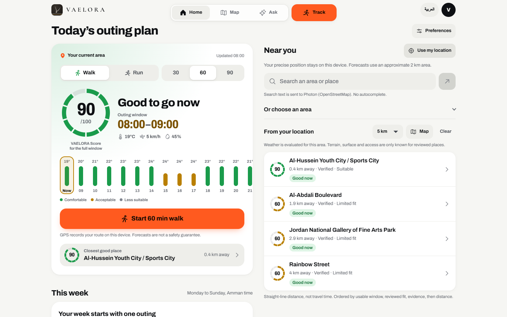

# VAELORA

**Outdoor activity intelligence for Greater Amman: plan with live conditions, track walks and runs, analyze local progress, and share privacy-aware recaps.**

VAELORA is a bilingual web application and installable PWA for deciding when and where to be active outdoors. It combines deterministic weather-aware recommendations, reviewed activity places, location-aware discovery, GPS activity recording, local analysis, mapping, and a grounded AI assistant.

**Plan → Track → Analyze → Share**

[Open the live application](https://vaelora-chi.vercel.app) · Current geographic focus: **Greater Amman, Jordan**

## What is VAELORA?

Outdoor plans depend on more than a temperature reading. VAELORA combines walking or running intent, outing duration, time, weather preferences, nearby context, and documented place characteristics to produce clear options without silently relaxing constraints.

Weather primarily helps determine **when** conditions are suitable and secondarily helps compare **where** to go. The recommendation engine remains deterministic and evidence-aware: unknown terrain, surfaces, access, or conditions stay unknown, and the product does not present recommendations as safety guarantees.

## Core experience

| Stage | What VAELORA does |
| --- | --- |
| **Plan** | Choose walking or running, duration, day, preferences, and an optional location. Review the VAELORA Score, live conditions, complete outing windows, nearby places, and alternatives. |
| **Track** | Record a foreground activity with browser geolocation, a live route, timer, distance, pace, speed, and explicit pause, resume, and finish controls. |
| **Analyze** | Review the saved route, activity metrics, available start-weather context, history, weekly progress, and separate walking/running pace statistics when valid. |
| **Share** | Generate one of three local 1080×1440 activity cards with endpoint privacy zones, or explicitly export the precise route as GPX. |

## Key features

### Planning and discovery

- Deterministic walking and running recommendations for Greater Amman
- Live Open-Meteo conditions and hourly weather-aware VAELORA Scores
- Complete 30, 60, and 90-minute outing windows
- Today, tomorrow, and three-day planning views
- Location-aware nearby discovery with approximate straight-line distance
- Reviewed activity places with explicit terrain, surface, fit, evidence, and uncertainty
- Interactive MapLibre maps with OpenStreetMap tiles, marker clustering, and selected-place behavior
- Compare Areas, Saved Areas, optional preferences, and bilingual place search
- Clear no-location, unavailable-weather, no-window, and unsupported-constraint states

### Tracking, analysis, and sharing

- Browser GPS recording for walking and running with point-quality and movement filters
- Live route drawing, timer, distance, pace, speed, and GPS status
- Pause, resume, finish, interruption recovery, and unfinished-session drafts
- Device-local activity history, summaries, profile statistics, and weekly progress
- Local GPX 1.1 generation with an explicit precise-location confirmation
- Three locally generated activity-card layouts with English and Arabic output
- Privacy-aware share rendering that removes route geometry around both endpoints

### Product experience

- Ask VAELORA, a grounded single-turn outdoor recommendation assistant
- English and Arabic interfaces with RTL layouts
- Optional guest profile and preferences stored on the device
- Responsive mobile and desktop layouts with reduced-motion support
- Installable PWA with a public offline shell for local tracking and history workflows
- App-like navigation: screens, place profiles, recaps and sheets have hash routes, so Back, Forward and refresh behave like an installed app without interrupting a recording
- Local backup and restore: export all finished activities as a JSON file, import with strict validation and duplicate protection, and request persistent browser storage
- A fitness-app interface around the VAELORA V icon: a ten-segment VAELORA Score ring, an hour-by-hour comfort strip with the best window boxed in gold, a dark full-screen recorder with a plan dial, real weekly progress (active-day ring and daily distance chart), ember actions, leaf and gold conditions, and one Phosphor icon set in light and dark themes

## Product screenshots

Captured from the production build with synthetic forecast data and simulated GPS.

### Plan

<p align="center">
  
  
  
</p>
<p align="center"><sub><strong>Plan band and meteogram</strong> · <strong>Reviewed place</strong> · <strong>Arabic RTL</strong></sub></p>

### Track, recap and profile

<p align="center">
  
  
  
</p>
<p align="center"><sub><strong>Live recorder</strong> · <strong>Recap</strong> · <strong>Profile</strong></sub></p>

### Ask and desktop

<p align="center">
  
</p>
<p align="center"></p>

## Technology

| Area | Implementation |
| --- | --- |
| Application | Next.js App Router, React, TypeScript, Tailwind CSS |
| Maps | MapLibre GL with OpenStreetMap raster tiles |
| Weather | Open-Meteo, normalized through a server-side weather pipeline |
| Recommendations | Pure deterministic domain logic with configurable scoring and best-time policies |
| AI | Provider adapter with Groq and OpenAI support; production currently uses Groq |
| Local data | IndexedDB for activities and drafts; bounded browser storage for profile, preferences, and saved areas |
| PWA | Web app manifest, service worker, same-origin public shell assets |
| Hosting | Vercel |

## Architecture

VAELORA keeps product presentation, external data, deterministic decisions, local activity data, and AI orchestration separate:

1. The **UI layer** collects intent and presents plans, maps, tracking, recaps, and local progress.
2. The **recommendation domain** filters eligible reviewed places, applies activity fit and hard constraints, scores environmental conditions, finds complete time windows, and returns leading matches.
3. The **weather pipeline** validates, retrieves, normalizes, and caches hourly Open-Meteo data on the server.
4. The **location and map layer** handles reviewed place data, approximate nearby ordering, dynamic Greater Amman weather cells, search references, and MapLibre rendering.
5. The **tracking layer** filters browser GPS points, calculates metrics, and persists drafts and completed activities locally.
6. The **AI layer** extracts structured intent and invokes VAELORA's existing tools; it does not calculate or invent places, weather, scores, or best-time windows.

Detailed design and validation notes live in [`docs/`](docs/).

## AI — Ask VAELORA

Ask VAELORA is a focused recommendation interface rather than an unrestricted chatbot. The model interprets an English or Arabic request and produces validated structured intent. VAELORA's deterministic tools then resolve eligibility, weather, constraints, scoring, time windows, and matches. Final answers are checked against tool output and include a safe factual action trace instead of hidden reasoning.

The provider sits behind an adapter, and AI credentials remain in server-only environment variables. The application still supports manual planning when AI configuration is absent or unavailable.

See [AI agent architecture, contracts, configuration, and evaluation](docs/ai-agent.md).

## Privacy

VAELORA uses a local-first activity model:

- Recorded GPS points, unfinished drafts, completed activities, history, and route metrics are stored in IndexedDB on the current device.
- Guest profile data, preferences, locale, appearance, and saved area IDs use bounded browser storage. There is no account, cloud activity backup, or cross-device sync.
- Backups are JSON files the user saves and imports locally. They contain precise routes and are never uploaded. Imports are validated with the same rules as stored activities; a damaged file imports nothing.
- Hash routes carry only screen names, sheet names, reviewed place IDs and local activity IDs, never coordinates.
- Dynamic nearby weather requests use a coarse validated cell identifier rather than sending the exact browser GPS coordinate to the discovery endpoint.
- Private routes and activity history are not sent to the AI provider. Search text is sent to Photon, weather requests use Open-Meteo, and viewed map regions are requested from the tile provider.
- Share cards are rendered locally. They remove 300-metre zones around both route endpoints, but a remaining route shape may still be recognizable; this is risk reduction, not anonymity.
- GPX export is separate and intentionally contains precise route coordinates.
- API credentials are server-side, use no `NEXT_PUBLIC_` prefix, and must never be committed.

See [production security and privacy controls](docs/production-security.md) and the [V2.3 privacy notes](docs/v23.md#local-recap-sharing-and-progress).

## Quality and validation

The repository includes offline domain, dataset, weather, security, tracking, UI, navigation, backup and AI contract tests. The V2.4 verification (October 25, 2026) records:

- **182/182** repository tests passed, including backup/restore, hash routing, copy coverage and refresh-policy cases
- **28/28** fixed AI replay evaluations and **16/16** V2 grounding/contract checks passed
- Dataset validation passed for 35 researched candidates, 11 production places, and 9 weather reference areas
- TypeScript, zero-warning ESLint, production build (Turbopack), and PWA asset generation passed
- Synthetic Playwright flows passed against the production build in English and Arabic at 320, 390, 430 and 1440 px, light and dark: onboarding, location states, plan and meteogram, routed place sheet, map, Back/Forward/refresh, recording across navigation, pause/resume, recap, three PNG exports, GPX, progress, profile, backup export/import and errors, Ask, with no horizontal overflow or page errors

These results use synthetic or mocked inputs where documented. Browser GPS validation is not physical-device field certification, and offline AI replay evaluates contracts and grounding rather than live-model language accuracy.

See [V2.3 verification](docs/v23.md#completion-validation--september-23-2026), [V2.1 QA](docs/v2.1-qa.md), and [weather validation](docs/weather-integration.md).

## Current limitations

- Production coverage is limited to VAELORA's defined urban Greater Amman service area and its reviewed places.
- Browser/PWA tracking is designed for foreground use. Continuous GPS while backgrounded or screen-locked is not guaranteed, particularly on iOS.
- Weather is regional forecast data rather than street-level or park-microclimate certainty. AQI is not currently assessed.
- Place facts follow the evidence dataset. Unknown terrain, surface, access, opening conditions, shade, or accessibility are not inferred.
- Recommendations are provisional comfort guidance, not medical advice, route verification, or a guarantee of safety or access.
- Weather, search, AI, and new map tiles require connectivity. Previously cached public shell assets and device-local data have narrower offline behavior.
- Device-local activities and profiles can be lost if browser storage is cleared. VAELORA requests persistent storage and offers a manual JSON backup, but there is no cloud copy.
- Physical-device GPS accuracy, battery use, install prompts, and background behavior still require device-specific testing.

## Documentation

- [V2.4 redesign, navigation, backup and CI](docs/v24-redesign.md)
- [Product context](PRODUCT.md) and [design system](DESIGN.md)
- [V2.3 real-user architecture, privacy, and QA](docs/v23.md)
- [V2.2 product experience](docs/v2.2-product.md)
- [V2.1 tracking, analysis, PWA, and privacy architecture](docs/v2.1-product.md)
- [V2 recommendation architecture](docs/v2-product.md)
- [AI agent and evaluation](docs/ai-agent.md)
- [Weather integration](docs/weather-integration.md)
- [Activity-area research and evidence policy](docs/research/activity-areas/README.md)
- [Domain foundation](docs/domain-foundation.md)
- [Production security](docs/production-security.md)
- [V2 QA](docs/v2-qa.md) and [V2.1 QA](docs/v2.1-qa.md)

## Local development

Use Node.js 24 LTS and npm.

```sh
npm ci
npm run dev
```

Open [http://localhost:3000](http://localhost:3000). Planning, maps, weather, and local tracking do not require an AI credential. Optional server-only AI configuration is documented with placeholders in [`.env.example`](.env.example).

### Validation commands

```sh
npm run validate
npm test
npm run eval
npm run typecheck
npm run lint
npm run build
```

The same checks run in GitHub Actions on every pull request and on pushes to `main` ([.github/workflows/ci.yml](.github/workflows/ci.yml)). CI reads no secrets; AI checks use the offline replay evaluation.

`npm run qa:browser` runs the synthetic Playwright flows in English and Arabic at 320, 390, 430 and 1440 px. It needs Playwright (`VAELORA_PLAYWRIGHT_MODULE` may point to an installed copy), Microsoft Edge (`VAELORA_BROWSER_CHANNEL` to override) and a running server (`VAELORA_QA_URL`, default http://localhost:3001). It is not part of CI.

`npm run smoke:weather` performs a controlled live Open-Meteo check. `npm run smoke:agent` uses a configured live provider; neither is required for offline unit tests. Never commit `.env.local` or API credentials.

## Scope

VAELORA currently supports walking and running. It does not include authentication, social feeds, cloud GPS storage, wearables, or native mobile tracking.
